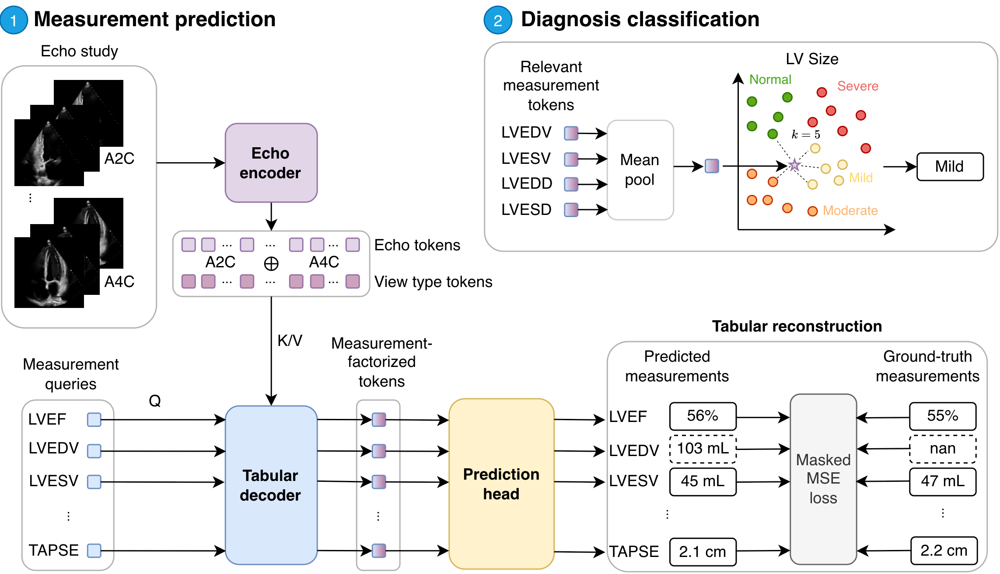

# EchoTab

This is the official PyTorch implementation of EchoTab.

[](https://arxiv.org/abs/2610.13599)
[](https://opensource.org/licenses/MIT)

If you find this work useful, please cite:

```bibtex
@misc{liman2026echotablearningmeasurementgroundedrepresentations,
      title={EchoTab: Learning Measurement-Grounded Representations for Echocardiographic Diagnosis through Tabular Reconstruction}, 
      author={Michelle Espranita Liman and Ioana Ionac and Alexander Müller and Eimo Martens and Daniel Rueckert and Philip Müller},
      year={2026},
      eprint={2610.13599},
      archivePrefix={arXiv},
      primaryClass={cs.LG},
      url={https://arxiv.org/abs/2610.13599}, 
}
```

EchoTab is a measurement-grounded representation learning framework for multi-view echo studies. Given an echo study, each individual view is first encoded by the echo encoder, resulting in a set of echo tokens per view. A tabular decoder with measurement queries then associates tokens across views with specific measurements, producing measurement tokens that the prediction head maps to the final measurements. The framework is trained end-to-end with a tabular reconstruction objective, after which relevant measurement tokens can be selected for accurate downstream diagnosis.

## 📋 Outline

1. [Architecture](#architecture)
2. [Setup](#setup)
3. [Model Usage](#model-usage)
4. [Data Preparation](#data-preparation)
5. [Training and Evaluation](#training-and-evaluation)

<a id="architecture"></a>
## 🧩 Architecture

<p align="center">

</p>


| Component | File | Description |
|---|---|---|
| `EchoBranch` | [echotab/models/EchoBranch.py](echotab/models/EchoBranch.py) | Encodes each view's clip with the [EchoPrime](https://github.com/echonet/EchoPrime) video encoder (MViTv2-S). By default all local tokens per view are kept, background patches are masked out, and a learnable view-type embedding is added. Missing views are masked. |
| `TabularBranch` | [echotab/models/TabularBranch.py](echotab/models/TabularBranch.py) | One learnable embedding per measurement, used as measurement queries. |
| `TabDecoder` | [echotab/models/TabDecoder.py](echotab/models/TabDecoder.py) | A stack of pre-norm blocks with cross-attention (measurement queries → echo tokens, with a learnable layer scale) and an FFN. It outputs one token per measurement. |
| `PredictionHead` | [echotab/models/prediction_head/](echotab/models/prediction_head/) | Maps each measurement token to a scalar. Three variants (`model.prediction_head.head_type`): <br/>• `independent` (`IndependentHeads`): a separate MLP per measurement <br/>• `shared` (`SharedHead`): one MLP shared by all measurements <br/>• `partial_shared` (`PartialSharedHead`, default): a shared MLP plus a per-measurement low-rank weight delta, generated by a hypernetwork from the measurement query |

`EchoBranch`, `TabularBranch` and `TabDecoder` together form the `EchoTabEncoder` ([echotab/models/EchoTabEncoder.py](echotab/models/EchoTabEncoder.py)), which maps an Echo study to its measurement tokens. For inference, `EchoTabInference` ([echotab/models/EchoTabInference.py](echotab/models/EchoTabInference.py)) combines the EchoPrime view classifier, the `EchoTabEncoder` and the `PredictionHead`. The training objective is an MSE between the predicted and the observed measurements. Missing measurements are masked out, and each squared error is divided by the measurement's train-set variance, so every measurement contributes on its own scale.

<a id="setup"></a>
## 🛠 Setup

**1. Install**

Prerequisite: Install `uv`.
```bash
# Create the environment and install dependencies + the current package
uv sync
source .venv/bin/activate

# Path to this repository (used by the configs)
export ECHOTAB_ROOT=$(pwd)
```

**2. Download EchoPrime view classifier weights**

Download the EchoPrime view classifier weights (`view_classifier.pt`, in `model_data/weights/` of the [EchoPrime release](https://github.com/echonet/EchoPrime/releases/download/v1.0.0/model_data.zip)) and place them in `model_weights/`. The view classifier assigns the clips of a study to view types (see [Model Usage](#model-usage)).

**3. Download the pre-trained EchoTab weights**

Download the pre-trained EchoTab model [here](https://drive.google.com/file/d/1mRDfAeNOCD1CZomBokeXQ-ovyTIJzEX5/view?usp=share_link). Place them in `checkpoints/`.

**4. (Optional) Download EchoPrime echo encoder weights**

If you are pre-training EchoTab from scratch, also place the EchoPrime video encoder weights (`echo_prime_encoder.pt`, from the same release) in `model_weights/`. They initialize the echo encoder before pre-training. When you load a pre-trained EchoTab model, the encoder weights come from `checkpoints/echo_branch.ckpt` and this file is not needed.

<a id="model-usage"></a>
## 🫀 Model Usage

With a pre-trained EchoTab model, extract measurement tokens from an Echo study and map them to measurement predictions.

```python
import glob

from echotab.models.EchoTabInference import EchoTabInference
from echotab.util.echoprime import load_echoprime_clip

model = EchoTabInference(
    ckpt_dir='checkpoints/',  # contains config.yaml and the component checkpoints
    view_classifier_path='model_weights/view_classifier.pt',
)

# --- Option 1: Input a whole study ---
# Each clip is assigned to its most likely view type.
# Per view type, the clip with the highest confidence is used.
# Views that are not found are treated as missing.

# meas_tokens: (1, N_measurements, 768), in the order of model.labels
# meas_preds:  (1, N_measurements), in the units of data/mimic/phenotype_list.csv
meas_tokens, meas_preds, assignments = model(glob.glob('<path-to-study>/*.avi'))

# --- Option 2: Input clips with known view types ---
# The view type must be one of echotab.util.echoprime.VIEW_TYPES
meas_tokens, meas_preds = model.predict({
    'A2C': load_echoprime_clip('<path-to-study>/a2c.avi').unsqueeze(0),
    'A4C': load_echoprime_clip('<path-to-study>/a4c.avi').unsqueeze(0),
})

lvef_idx = model.labels.index('biplane_lvef')
lvef_token = meas_tokens[:, lvef_idx]  # (1, 768)
lvef = meas_preds[0, lvef_idx].item()  # LVEF in %
```

<a id="data-preparation"></a>
## 📊 Data Preparation

EchoTab is trained and evaluated on [MIMIC-IV-ECHO](https://physionet.org/content/mimic-iv-echo/1.0/) paired with the corresponding structured measurements. Set `data_dir` to the root directory of the prepared data (in the configs or on the command line):

```
<data_dir>/
├── pretrain/
│   ├── paired_echo_sr.csv                 # pretraining (train split)
│   └── diagnosis_labels_balanced.csv
├── val/
│   ├── paired_echo_sr.csv
│   └── diagnosis_labels.csv
└── test/
    ├── paired_echo_sr.csv
    └── diagnosis_labels.csv
```

### 1) Measurement list

[data/mimic/phenotype_list.csv](data/mimic/phenotype_list.csv) lists the 45 measurements that EchoTab reconstructs (`phenotype`, `description`, `unit`, `section`). The row order defines the order of the model's measurement tokens.

### 2) Paired Echo-measurement data for pretraining

`paired_echo_sr.csv` has one row per Echo clip with at least these columns:

- `echo_study_id`
- `echo_view`: view type of the clip, one of `echotab.util.echoprime.VIEW_TYPES`
- `echo_filepath`: full path to the clip (`.avi`)
- one column per measurement in `phenotype_list.csv`, in the units of its `unit` column (empty if not measured)

Per view type, one clip per study is used: a random one during training and the first one during evaluation. Views listed in `dataset.echo.excluded_view_types` are ignored.

### 3) Diagnosis labels for downstream evaluation

`diagnosis_labels*.csv` has the same `echo_study_id`, `echo_view` and `echo_filepath` columns, plus one column per diagnosis (`aortic_stenosis`, `aortic_regurg`, `mitral_stenosis`, `mitral_regurg`, `la_size`, `ra_size`, `lv_size`, `rv_size`, `lvef_class`, `rv_function`). The diagnosis columns hold ordinal severity grades (`Normal`, `Trace`, `Mild`, `Mild-Moderate`, `Moderate`, `Moderate-Severe`, `Severe`) and are empty if not reported.

[data/mimic/diagnosis_measurement_map.csv](data/mimic/diagnosis_measurement_map.csv) maps each diagnosis to the measurements that are clinically relevant for it.

<a id="training-and-evaluation"></a>
## 🏋🏻‍♀️ Training and Evaluation

### A) EchoTab pretraining

```bash
# base config: configs/base_pretrain_echotab.yaml
# the defaults are the hyperparameters used in the paper (see also scripts/run_pretrain_echotab.sh)
python run.py --config-name=base_pretrain_echotab \
    data_dir=<path-to-data> \
    max_epochs=30 \
    dataset.batch_size=4 \
    dataset.accum_iter=16 \
    model.prediction_head.head_type=partial_shared \
    train.params.lr_echo_branch=5e-5 \
    train.params.lr=1e-4
```
Important configs:
- Set `data_dir` in `configs/base_pretrain_echotab.yaml` (or pass it on the command line), and export `ECHOTAB_ROOT` (see [Setup](#setup)).
- Place the EchoPrime weights in `model_weights/echo_prime_encoder.pt` (see [Setup](#setup)). Otherwise the echo encoder starts from random weights.
- Prediction head: `model.prediction_head.head_type=independent|shared|partial_shared`
- Hypernetwork of the partially-shared head: `model.prediction_head.{hypernet_size,lora_rank,lora_alpha,hyper_hidden,cond_proj_dim}`
- TabDecoder depth / width: `model.tab_decoder.{num_layers,num_heads}`
- Echo tokens per view: all 392 local tokens with `model.echo.preserve_local_tokens=true`, or one (mean-pooled) token per view with `false`
- Background masking: `model.echo.use_bg_removal=true` with `dataset.echo.background_threshold`
- Freezing EchoPrime blocks: `train.encoder.echo.freeze_first_n_layers` (16 = fully frozen)
- Multi-GPU training: `num_gpus=<n>`

The best checkpoint (by `val_metrics/mean_r2`) is evaluated on the validation and test splits. Outputs under `<save_dir>/EchoTab-Pretrain/<experiment_name>/`:
- `checkpoints/`: the run config (`config.yaml`), the Lightning checkpoint and one checkpoint per component (`echo_branch.ckpt`, `tab_branch.ckpt`, `tab_decoder.ckpt`, `echo_projection.ckpt`, `tab_projection.ckpt`, `prediction_head.ckpt`)
- `metrics_final_{val,test}.csv`: per-measurement R², MAE, MSE, PCC and nMAE
- `predictions_final_{val,test}.csv`: per-study predictions and labels

### B) Downstream: diagnosis classification

A k-nearest-neighbour probe (k=5) is fitted on frozen EchoTab measurement tokens: the tokens of the selected measurements are averaged into one feature vector per study.

```bash
# base config: configs/base_knn.yaml
python run.py --config-name=base_knn \
    data_dir=<path-to-data> \
    echotab_run_dir=<path-to-pretraining-run> \
    downstream_task=diagnosis_ordinal_classification_mimic \
    downstream_task.target=aortic_stenosis \
    downstream_task.feature_source=measurement_tokens \
    downstream_task.paths.type=_balanced \
    validate=true \
    test=true
```
Important configs:
- `echotab_run_dir` is the output directory of the pretraining run (the one that contains `checkpoints/`)
- Diagnosis: `downstream_task.target` (see `configs/downstream_task/diagnosis_ordinal_classification_mimic.yaml`; `scripts/run_knn_echotab.sh` loops over all of them)
- Study representation:
  - `downstream_task.feature_source=measurement_tokens`: mean of the measurement tokens that `data/mimic/diagnosis_measurement_map.csv` maps to the diagnosis
  - `downstream_task.feature_source=measurement_tokens_all`: mean of the tokens of all measurement tokens
- Train split: `downstream_task.paths.type=_balanced` (class-balanced) or `""` (full)
- Run evaluation on the val set: `validate=true`
- Run evaluation on the test set: `test=true`

Metrics (accuracy, balanced accuracy, F1, precision, recall, AUROC, AUPRC and ordinal MAE) are logged to Weights & Biases under `final_val/` and `test/`. Confusion matrices are saved to the run directory.

To add a new downstream task, add a config file `<downstream-task>.yaml` to `configs/downstream_task/` and pass it via `downstream_task=<downstream-task>`.

## License

This project is licensed under the MIT License. See the [LICENSE](LICENSE) file for details.
